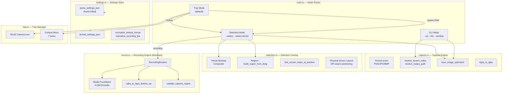

# Design Document: RustShot Core

## Overview

RustShot is a lightweight screenshot and screen recording utility for Windows and Linux, written in Rust. It operates in three modes: system tray (default), CLI, and selection overlay. The application captures screenshots in PNG/JPG/BMP, supports multi-monitor setups with DPI-aware coordinate mapping, provides interactive region selection via a fullscreen overlay, records screen regions to H.264 MP4 (Windows only), and persists user preferences in a hand-rolled JSON format.

This design covers the complete architecture of the existing codebase across all modules: `capture.rs`, `selection.rs`, `record.rs`, `settings.rs`, `tray.rs`, `cli.rs`, and `main.rs`.

### Key Design Decisions

1. **`Result<_, String>` error handling** — The project is an end-user tool, not a library. String errors are human-readable, composable with `format!`, and avoid custom error enum boilerplate.
2. **No serde dependency** — Settings JSON is tiny and stable. A hand-rolled parser/formatter in `settings.rs` avoids pulling ~30 transitive crates.
3. **`softbuffer` CPU rendering** — The selection overlay blits a full-screen screenshot into a framebuffer with crosshair/rectangle overlays. No GPU driver dependency, keeping the binary small and portable.
4. **Child-process architecture** — Tray mode spawns `--select` / `--select-record` child processes so the overlay event loop is isolated from the tray event loop, preventing deadlocks and simplifying shutdown.
5. **Closure-based dependency injection** — Core functions like `capture_screenshot_with`, `run_selection_with_clipboard`, and `open_screenshots_folder_with_handlers` accept closures for I/O operations, enabling thorough unit testing without mocking frameworks.

## Architecture



### Mode Routing

The application entry point (`main.rs`) uses `clap` to parse CLI arguments into an `Args` struct, then routes to one of three modes:

- **Tray Mode** (default): Creates system tray icon, registers global hotkeys (PrintScreen, Ctrl+Shift+R), enters `winit` event loop. Spawns child processes for capture/recording.
- **CLI Mode** (`--cli`, `--list`, `--output`, `--screen`, `--format`, `--window`): Single-shot capture, prints result, exits.
- **Selection Mode** (`--select`, `--select-record`): Opens fullscreen overlay, user drags to select region, copies to clipboard or starts recording.

### Child-Process IPC

- Tray spawns `--select` child for screenshots, `--select-record` for recordings.
- Recording stop signal uses a **Stop_Flag_File**: the parent writes a file to disk, the child polls for its existence and stops encoding.
- Child process exit status and stderr are captured by the parent for error reporting.

## Components and Interfaces

### capture.rs — Capture Engine

| Function | Purpose |
|---|---|
| `resolve_screen_index(index: Option<usize>, count: usize)` | Validates screen index against available count, returns `Result<usize, String>` |
| `default_screen_index(is_primary_flags)` | Returns index of primary monitor, falls back to 0 |
| `resolve_output_path(output: Option<PathBuf>, format: Format)` | Returns explicit path or generates timestamped filename |
| `resolve_output_path_in_dir(output, format, dir)` | Same but with custom base directory |
| `ensure_parent_directory(path)` | Creates parent dirs recursively (idempotent) |
| `save_image_optimized(image, path, format)` | Encodes and saves image; converts RGBA→RGB for JPG |
| `capture_screenshot(output, screen_index, format)` | High-level: resolve screen → capture → save |
| `capture_screenshot_with(...)` | Closure-injected version for testing |
| `bgra_to_rgba(pixels)` | In-place channel swap for Windows screen capture data |
| `list_screens()` | Returns `Vec<String>` of screen descriptions |
| `capture_active_window()` | Windows-only active window capture |

**Format enum**: `Png`, `Jpg`, `Bmp` — implements `Default` (Png), `extension()`, `to_image_format()`.

### selection.rs — Selection Overlay

| Type/Function | Purpose |
|---|---|
| `Region { x, y, width, height }` | Rectangle with i32 origin, u32 dimensions. Implements Copy, Clone, Debug |
| `VirtualDesktopCapture` | Holds composited screenshot bytes, dimensions, and screen offset |
| `ScreenLayoutInput` | Logical + physical screen geometry for DPI-aware layout |
| `PhysicalScreenLayout` | Resolved physical pixel positions for each monitor |
| `build_region_from_drag(start, end)` | Normalizes drag coordinates → `Option<Region>` (None if ≤5×5) |
| `find_screen_index_at_position(screens, cursor_pos)` | Hit-tests cursor against monitor bounds (exclusive right/bottom) |
| `preferred_screen_index(screens, cursor_pos)` | Cursor → primary → first fallback chain |
| `select_region()` | Full overlay flow: capture → display → drag → crop → return image |
| `select_region_for_recording()` | Same but returns `(Screen, Region)` for recording |
| `build_physical_screen_layouts(inputs)` | DPI-aware physical coordinate inference |
| `normalize_physical_screen_layouts(layouts)` | Shifts all layouts so minimum origin is (0,0) |
| `resolve_recording_selection(region, layouts)` | Validates region fits within single monitor, returns local coords |
| `logical_to_physical(value, scale_factor)` | Coordinate scaling with rounding |
| `virtual_desktop_scale_factor(screens)` | Returns primary monitor's scale factor |

**SelectionApp**: `winit` ApplicationHandler that manages the overlay window lifecycle, mouse tracking, crosshair/rectangle drawing, and result collection.

### record.rs — Recording Engine

| Type/Function | Purpose |
|---|---|
| `RecordingSession` | Manages recording thread, output path, stop flag |
| `RecordingSession::start(x, y, region, fps)` | Validates FPS, creates output path, spawns recording thread |
| `RecordingSession::stop()` | Signals stop via flag file, joins thread, returns output path |
| `validate_recording_start(fps)` | Rejects 0 FPS, >240 FPS, non-Windows platforms |
| `validate_capture_region(region, frame_w, frame_h)` | Ensures region fits within frame, no negative coords, no zero dimensions |
| `frame_duration_hns(fps)` | Converts FPS to hundred-nanosecond frame duration |
| `round_to_even(value)` | Rounds up to even (H.264 encoder requirement) |
| `rgba_to_bgra_bottom_up(rgba, w, h)` | Channel swap + vertical flip for Media Foundation |
| `pack_u32_pair(hi, lo)` | Packs two u32 into u64 for MF attribute encoding |

### settings.rs — Settings Store

| Type/Function | Purpose |
|---|---|
| `Settings` | Struct: `default_format`, `recording_fps`, `auto_start`, `screenshots_dir`, `recordings_dir` |
| `parse_settings_json(json)` | Hand-rolled JSON parser → Settings (defaults for missing/invalid) |
| `format_settings_json(settings)` | Settings → JSON string with proper escaping |
| `normalize_default_format(value)` | Validates format string, falls back to "png" |
| `normalize_recording_fps(value)` | 0 → 30, otherwise pass-through |
| `escape_json_string(value)` | Escapes `\`, `"`, `\n`, `\r`, `\t` |
| `unescape_json_string(value)` | Reverses escape sequences |
| `extract_json_string/number/bool(json, key)` | Type-safe JSON value extraction |
| `find_json_value(json, key)` | Locates raw value string after key in JSON |
| `generate_timestamp()` | `YYYYMMDD_HHMMSS_NNNNNNNNN` format |

### cli.rs — CLI Handler

| Function | Purpose |
|---|---|
| `effective_cli_format(explicit, output, settings_format)` | Priority: explicit flag > output extension > settings |
| `cli_format_flag_present_in(args)` | Scans argv for `--format`/`-f` (skips values of `--output`/`--screen`) |
| `format_from_extension(ext)` | Maps file extension to Format (case-insensitive) |
| `should_run_cli_mode(args)` | True if any CLI-specific flag is set |
| `selection_stderr_message(error)` | Returns None for "Selection cancelled", Some for others |
| `format_screen_list_output(screens)` | Formats screen list with indentation |

### tray.rs — Tray Manager

| Function | Purpose |
|---|---|
| `build_default_icon_pixels()` | Generates 32×32 RGBA camera glyph (blue body, white lens) |
| `create_tray()` | Creates TrayIcon with icon and 7-item context menu |
| `menu_receiver()` | Returns static menu event receiver |

### main.rs — Application Lifecycle

| Function | Purpose |
|---|---|
| `RustShotApp::new()` | Registers hotkeys, loads settings |
| `run_cli(args)` / `run_cli_with_capture(...)` | CLI mode execution with closure injection |
| `run_selection()` / `run_selection_with_clipboard(...)` | Selection mode with clipboard integration |
| `run_select_record()` | Selection + recording flow |
| `decide_app_mode(args)` | Routes to Tray/CLI/Selection based on args |
| `sync_autorun(enabled)` | Windows registry auto-start management |

## Data Models

### Core Types

```rust
// capture.rs
#[derive(Debug, Clone, Copy, PartialEq)]
pub enum Format {
    Png,  // Default
    Jpg,
    Bmp,
}

// selection.rs
#[derive(Debug, Clone, Copy)]
pub struct Region {
    pub x: i32,       // Can be negative (multi-monitor)
    pub y: i32,
    pub width: u32,   // Always positive
    pub height: u32,
}

pub struct VirtualDesktopCapture {
    pub pixels: Vec<u8>,    // RGBA bytes
    pub width: u32,
    pub height: u32,
    pub screen_x: i32,      // Virtual desktop offset
    pub screen_y: i32,
}

pub struct ScreenLayoutInput {
    pub logical_x: i32,
    pub logical_y: i32,
    pub logical_width: u32,
    pub logical_height: u32,
    pub physical_width: u32,
    pub physical_height: u32,
    pub is_primary: bool,
}

pub struct PhysicalScreenLayout {
    pub x: i32,
    pub y: i32,
    pub width: u32,
    pub height: u32,
}
```

### Settings Model

```rust
// settings.rs
#[derive(Debug, Clone, PartialEq)]
pub struct Settings {
    pub default_format: String,      // "png", "jpg", "bmp"
    pub recording_fps: u32,          // Default: 30, normalized: 0→30
    pub auto_start: bool,            // Default: true
    pub screenshots_dir: PathBuf,    // Default: Pictures/RustShot/
    pub recordings_dir: PathBuf,     // Default: Pictures/RustShot/Recordings/
}
```

### Recording Session

```rust
// record.rs
pub struct RecordingSession {
    output_path: PathBuf,
    recording_thread: Option<JoinHandle<Result<(), String>>>,
    stop_flag_path: PathBuf,
}
```

### CLI Arguments

```rust
// main.rs (via clap derive)
pub struct Args {
    pub cli: bool,
    pub select: bool,
    pub select_record: bool,
    pub window: bool,
    pub list: bool,
    pub output: Option<PathBuf>,
    pub screen: Option<usize>,
    pub format: Option<CliFormat>,  // png, jpg, bmp
}
```

### Key Constants

| Constant | Value | Context |
|---|---|---|
| Icon size | 32×32 | Tray icon dimensions |
| Min selection | 6×6 pixels | Minimum drag region to accept |
| Camera body color | RGB(41, 128, 185) | Tray icon blue |
| Lens color | RGB(255, 255, 255) | Tray icon white |
| HNS per second | 10,000,000 | Media Foundation time unit |
| Default FPS | 30 | Recording frame rate |
| Max FPS | 240 | Recording FPS ceiling |
| Crosshair color | Red | Pre-drag cursor indicator |
| Selection border | 3px cyan | Active drag rectangle |

