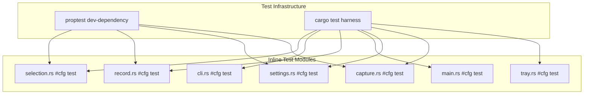

# Design Document: Comprehensive Test Suite for RustShot

## Overview

This design covers adding thorough unit tests and property-based tests across all RustShot modules. The project already has inline `#[cfg(test)]` tests in each source file; this effort extends coverage to additional edge cases, boundary conditions, and introduces property-based testing via `proptest`.

All new tests follow the existing pattern: inline `#[cfg(test)] mod tests` blocks within each source file. No new test files or directories are created. The `proptest` crate is added as a dev-dependency in `Cargo.toml`.

The modules under test and their key pure functions:

| Module | Key Functions |
|--------|--------------|
| `selection.rs` | `ranges_overlap`, `monitor_scale_ratio`, `scaled_gap`, `logical_to_physical`, `build_physical_screen_layouts`, `normalize_physical_screen_layouts`, `build_region_from_drag`, `resolve_recording_selection`, `find_screen_index_at_position`, `preferred_screen_index` |
| `cli.rs` | `cli_format_flag_present_in`, `effective_cli_format`, `output_extension`, `format_from_extension`, `unsupported_output_extension`, `should_run_cli_mode`, `format_screen_list_output`, `selection_stderr_message`, `write_error_line` |
| `record.rs` | `validate_recording_start`, `frame_duration_hns`, `round_to_even`, `validate_capture_region`, `rgba_to_bgra_bottom_up`, `pack_u32_pair` |
| `main.rs` | `decide_app_mode`, `run_cli_with_capture`, `run_selection_with_clipboard`, `sync_autorun_with_handlers`, `open_screenshots_folder_at_with_handlers`, `quoted_autorun_command` |
| `settings.rs` | `format_settings_json`, `parse_settings_json`, `normalize_default_format`, `normalize_recording_fps`, `extract_json_string`, `extract_json_number`, `extract_json_bool` |
| `capture.rs` | `bgra_to_rgba`, `save_image_optimized`, `ensure_parent_directory`, `resolve_output_path_in_dir`, `resolve_screen_index`, `default_screen_index` |
| `tray.rs` | `build_default_icon_pixels` |

## Architecture



The architecture is flat: each source file contains its own test module. Property-based tests live alongside unit tests in the same `mod tests` block, gated behind `use proptest::prelude::*;`. No shared test utilities or fixtures are needed.

Platform-conditional tests use `#[cfg(target_os = "windows")]` and `#[cfg(not(target_os = "windows"))]` attributes for recording validation (FPS acceptance/rejection).

## Components and Interfaces

### 1. proptest Dev-Dependency

Added to `Cargo.toml`:

```toml
[dev-dependencies]
proptest = "1"
```

### 2. Test Organization Per Module

Each module's `mod tests` block is extended with:
- Additional unit tests for edge cases and boundary conditions
- `proptest!` macro blocks for property-based tests (where applicable)

No new public APIs are introduced. All tests call existing `pub` or `pub(crate)` functions.

### 3. Platform-Conditional Tests

Recording validation tests use conditional compilation:

```rust
#[cfg(target_os = "windows")]
#[test]
fn validate_recording_start_accepts_valid_fps_on_windows() { ... }

#[cfg(not(target_os = "windows"))]
#[test]
fn validate_recording_start_rejects_on_non_windows() { ... }
```

## Data Models

No new data models are introduced. Tests operate on existing types:

- `Region { x: i32, y: i32, width: u32, height: u32 }` — selection coordinates
- `Settings { screenshots_dir, recordings_dir, default_format, recording_fps, auto_start }` — app config
- `Format { Png, Jpg, Bmp }` — image output format enum
- `PhysicalScreenLayout` — computed monitor positions (internal to selection.rs)
- `ScreenLayoutInput` — monitor metadata input (internal to selection.rs)

For property-based tests, `proptest` strategies generate:
- Arbitrary `i32` coordinates and `f32` scale factors
- Random `Settings` objects with supported format strings and valid FPS ranges
- Random RGBA pixel buffers of small dimensions
- Random range pairs for overlap testing

