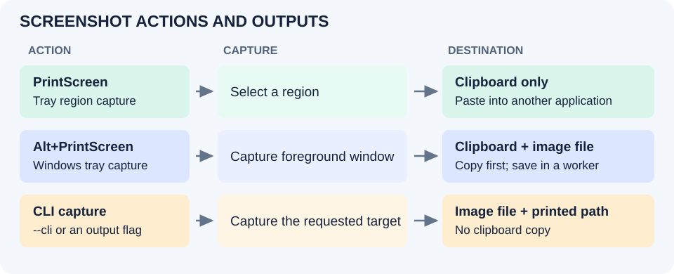

<p align="center">
  
  
  
  
</p>

# 📸 RustShot — *your screen, captured in a snap!*

> **One binary. Zero hassle. Screenshots and recordings done right.**

RustShot is a lightning-fast ⚡ screenshot and screen recording utility,
written in Rust 🦀 because life's too short for slow tools.

---

## 🌟 Why RustShot?

| Feature | Status | Description |
|---------|--------|-------------|
| 📷 **Screenshots** | ✅ Ready | Capture full screen or select any region |
| 🎬 **Screen Recording** | ✅ Ready | Record to MP4 (H.264) — **(Windows only)** |
| 🖱️ **Region Selection** | ✅ Ready | Click and drag — it's that easy |
| 💾 **Multiple Formats** | ✅ Ready | PNG, JPG, BMP — take your pick! |
| 🖥️ **Multi-Monitor** | ✅ Ready | Got 3 monitors? We got you covered 😎 |
| ⚡ **Tray Mode** | ✅ Ready | Sits quietly in your system tray like a good tool should |
| 🪟 **Active Window** | ✅ Ready | Grab just the focused window (Windows) |

---

## 🎯 The "I just want a screenshot" guide

```bash
# That's it. Seriously. One command.
RustShot --cli
```

🎉 Done! Your screenshot is saved. You can close this README now.

...still here? Cool, there's more! 👇

---

## 🌍 Platform support

| Platform | Screenshot capture | Region overlay | Recording |
|----------|--------------------|----------------|-----------|
| 🪟 Windows | Monitors and foreground windows | Supported | H.264 MP4 |
| 🐧 Linux X11 | Monitors | Supported | Unavailable |
| 🐧 Linux Wayland | Full desktop through the screenshot portal | Requires the existing X11 capture path | Unavailable |
| 🍎 macOS | Monitors | Supported | Unavailable |

See the [capture guide](docs/capture-guide.md) for target restrictions, output
destinations, settings, and troubleshooting.

---

## 📋 Prerequisites

### 🪟 Windows & 🍎 macOS

Source builds use the mise-managed tools described below, together with the
native development tools required by your Rust target.

### 🐧 Linux

On Wayland, full-desktop CLI screenshots use `xdg-desktop-portal` and its desktop
backend. For example, `RustShot --cli --output shot.png` uses the session portal.
Single-screen (`--screen`) and active-window (`--window`) requests are rejected
on Wayland. Region selection still requires the existing X11 capture path.
Portal helpers have unit coverage; an actual Wayland compositor is required to
verify the permission dialog and screenshot at runtime.

Source builds need X11, GTK 3, libxdo, and pkg-config. The
[CI workflow](.github/workflows/ci.yml) lists the Linux build dependencies.

<details>
<summary>🔽 Ubuntu / Debian</summary>

```bash
sudo apt-get install pkg-config libgtk-3-dev libxdo-dev libxcb1-dev libxcb-render0-dev libxcb-shape0-dev libxcb-xfixes0-dev
```
</details>

<details>
<summary>🔽 Fedora / RHEL</summary>

```bash
sudo dnf install libxcb-devel
```

Install GTK 3 and libxdo development libraries and pkg-config as well.
</details>

<details>
<summary>🔽 Arch Linux (btw)</summary>

```bash
sudo pacman -S libxcb
```

Install GTK 3, libxdo, and pkg-config as well.
</details>

---

## 🔨 Building from source

Install the tools pinned in `mise.toml` before the first build:

```bash
rtk proxy mise install
rtk proxy mise run build          # Portable optimized release
rtk proxy mise run build:native   # Release optimized for this CPU
```

Both release tasks use optimization level 3, full LTO, and one code-generation
unit. `build:native` additionally enables `target-cpu=native`; use it for the
machine on which the binary will run. Use `build` for distributed binaries.

The executable lands here:
```text
target/release/RustShot       # Linux / macOS
target/release/RustShot.exe   # Windows
```

---

## 🚀 Usage

### 🖥️ Tray mode — *set it and forget it*

```bash
RustShot
```

Just launch it. An icon appears in your system tray. Now use hotkeys like a pro:

| 🎹 Hotkey | 🎬 What happens | 🤔 When to use |
|-----------|-----------------|----------------|
| `PrintScreen` | Select region → screenshot → clipboard 📋 | When you need *just that part* |
| `Alt+PrintScreen` | Copy the foreground window to the clipboard; save a copy in the background | Paste into another application with `Ctrl+V` |
| `Ctrl+Shift+R` | Start recording 🔴 | Showtime! |
| `Ctrl+Shift+R` again | Stop recording → save MP4 🎬 | And... cut! |
| Right-click tray icon | Open menu 📋 | For everything else |

**📂 Where does stuff go?**

| What | Where | Why |
|------|-------|-----|
| Region captures | 📋 Clipboard only | Quick sharing! |
| Window hotkey captures | Clipboard and `Pictures\RustShot\` | Immediate paste, plus a saved copy |
| CLI captures | `Pictures\RustShot\` or the requested output path | Saved files |
| Recordings | `Pictures\RustShot\recordings\` | Movie night 🍿 |



The command examples assume `RustShot` is on `PATH`. From a source checkout,
use the executable paths shown in the build section; capitalization matters
on case-sensitive systems.

> 💡 **Tip:** Windows autostart follows the `auto_start` setting and is enabled by default. Change it in Settings.

---

### 📸 CLI examples — *for the command-line warriors*

#### 1️⃣ Quick screenshot
```bash
RustShot --cli
# 📸 *click* — saved with an auto-generated name
```

#### 2️⃣ Custom filename
```bash
RustShot --output epic_screenshot.png
# 💾 Saved exactly where you want it
```

#### 3️⃣ Pick your format
```bash
RustShot --format jpg --output photo.jpg    # 📷 JPEG — smaller file
RustShot --format bmp --output retro.bmp    # 🖼️ BMP — for that retro feel
RustShot --format png --output crisp.png    # 🎨 PNG — pixel perfect (default)
```

#### 4️⃣ Multi-monitor magic
```bash
RustShot --list              # 👀 See all your screens
RustShot --screen 1          # 📺 Capture monitor #2
RustShot --screen 0          # 📺 Capture monitor #1 (indexing starts at 0!)
```

#### 5️⃣ Capture the active window
```bash
RustShot --window            # 🪟 Just the focused window, nothing else
```

---

## 📖 Cheat sheet

```text
🎯 BASIC
  RustShot                        → 🖥️  tray mode (recommended)
  RustShot --cli                   → 📸  quick screenshot
  RustShot --window                → 🪟  active window (Windows only)

🎨 OUTPUT
  RustShot --output file.png       → 💾  save to custom file
  RustShot --format jpg            → 🖼️  save as JPG

🖥️ SCREENS
  RustShot --list                  → 📋  list monitors
  RustShot --screen 1              → 📺  capture specific monitor
```

---

## ⚙️ All options

```text
    --cli              📸  take one screenshot and exit
-w, --window           🪟  capture the active window (Windows only)
-o, --output <OUTPUT>  💾  output file name or path
-f, --format <FORMAT>  🎨  image format: png, jpg, bmp
-s, --screen <SCREEN>  🖥️  screen number (0-indexed)
-l, --list             📋  list available screens
-h, --help             ❓  show help
-V, --version          🏷️  show version
```

---

## 🛠️ Development

Use [mise](https://mise.jdx.dev/) to install the configured Rust toolchain and RTK:

```bash
rtk proxy mise trust
rtk proxy mise install
rtk proxy mise run ci
rtk proxy mise run build
```

Read `mise.toml` before you trust a checkout.
The `rust-toolchain.toml` file selects Rust for both mise and direct Cargo commands.
The `ci` task runs the local format, Clippy, duplication and test checks.
Use `rtk proxy mise tasks ls` to list the other tasks.
Keep `rust-toolchain.toml` and `mise.toml` in Git. The generated `mise.lock`
and personal overrides in `mise.local.toml` are ignored by this repository.
Linux builds still require the X11 and GTK libraries listed in the CI workflow.
The Linux tray uses the KSNI backend; GTK 0.19 supplies the existing desktop
initialization and event servicing.

```bash
rtk proxy mise run check       # Verify compilation
rtk proxy mise run test        # Run both Rust packages' tests
rtk proxy mise run fmt         # Format Rust code
rtk proxy mise run lint        # Lint all targets
rtk proxy mise run bench       # Measure performance
rtk proxy mise run docs:pdf    # Build the illustrated textbook
rtk proxy mise exec -- python wiki/lint.py # Validate the knowledge base
```

### 📐 The TDD way of life

```text
1. ✏️  Write a test              "This is what I expect"
2. ❌  Watch it fail              "Yep, it doesn't work yet"
3. 🔧  Write the minimal fix     "Just enough to make it green"
4. ✅  Watch it pass              "Sweet success!"
5. 🧪  Run ALL tests              "Nothing else broke... right?"
```

---

## 📥 Downloads

Head over to [**Releases**](https://github.com/stden/RustShot/releases) and grab what you need:

| File | What is it | For whom |
|------|-----------|----------|
| `rustshot.exe` | 📦 Portable executable | "I don't like installers" |
| `RustShotSetup.exe` | 🔧 Windows installer | "Set it up properly" |

---

## 📚 Reference files

| File | Description |
|------|------------|
| 📖 [RustShot.typ](RustShot.typ) | Illustrated textbook: capture workflows, Rust architecture, testing, and performance |
| 📘 `AGENTS.md` | General rules for AI assistants |
| 🤖 `CLAUDE.md` | Instructions for Claude |
| 💎 `GEMINI.md` | Instructions for Gemini |
| 🗺️ [docs/README.md](docs/README.md) | Documentation map & repository guide |
| 🧠 [wiki/index.md](wiki/index.md) | Retrieval knowledge base index |
| 📦 [INSTALLERS.md](docs/INSTALLERS.md) | 🎓 Tutorial: build Windows installers for Rust apps |
| 🚀 [INNO_SETUP_PIPELINE.md](docs/INNO_SETUP_PIPELINE.md) | 🎓 Lesson: Inno Setup + GitHub Actions pipeline |
| ⚙️ [github-pipeline.md](docs/github-pipeline.md) | 🎓 Guide: GitHub Actions CI/CD pipeline for Rust |

---

## 📜 License

`MIT OR Apache-2.0` — use it however you like! 🎉

---

<p align="center">
  <b>Made with 🦀 and ❤️</b><br/>
  <i>Because every screen deserves to be remembered.</i>
</p>

---

[Версия на русском языке (README.ru.md)](README.ru.md)

## Testing

- Repository-wide testing/TDD guide: `TESTING_TDD_GUIDE.md`
- Stack checklist: `TESTING_CHECKLIST_RUST.md`
- [Architecture and capture-flow diagrams](docs/architecture-tutorial.md).

Run the managed checks and export a coverage report:

```bash
rtk proxy mise run ci
rtk proxy mise run coverage
```

Coverage uses `cargo-llvm-cov` and writes `target/coverage.json`. Install the
tool with `rtk proxy mise use --global cargo:cargo-llvm-cov` if it is missing.

Run focused performance benchmarks with allocation and steady-state work
measured separately:

```bash
rtk proxy mise exec -- cargo bench --bench benchmarks -- "recording_frame_preparation|jpeg_color_preparation|overlay_workloads|overlay_redraw_scheduling"
```

Criterion reports are stored under `target/criterion/`. Recording benchmarks
compare allocated and reused buffers, row reversal, channel conversion, and
odd-dimension padding at 1080p and 4K. The Windows desktop benchmark also
measures CPU use and actual input counts, checks the crosshair at screen edges,
and verifies the final cursor position after input stops:

```powershell
rtk proxy mise exec -- pwsh -NoProfile -File tools/benchmark_overlay_windows.ps1 -CsvPath target/overlay.csv
```

This desktop benchmark temporarily moves the cursor and restores it afterward.

## Illustrated textbook

The editable textbook source is [RustShot.typ](RustShot.typ), with vector
illustrations in [docs/diagrams/](docs/diagrams/). Build the PDF with the managed
Typst tool:

```bash
rtk proxy mise run docs:pdf
```

The result is `RustShot.pdf` in the repository root. Generated PDFs and page
previews are ignored build artifacts; the Typst source and SVG illustrations
are versioned.
