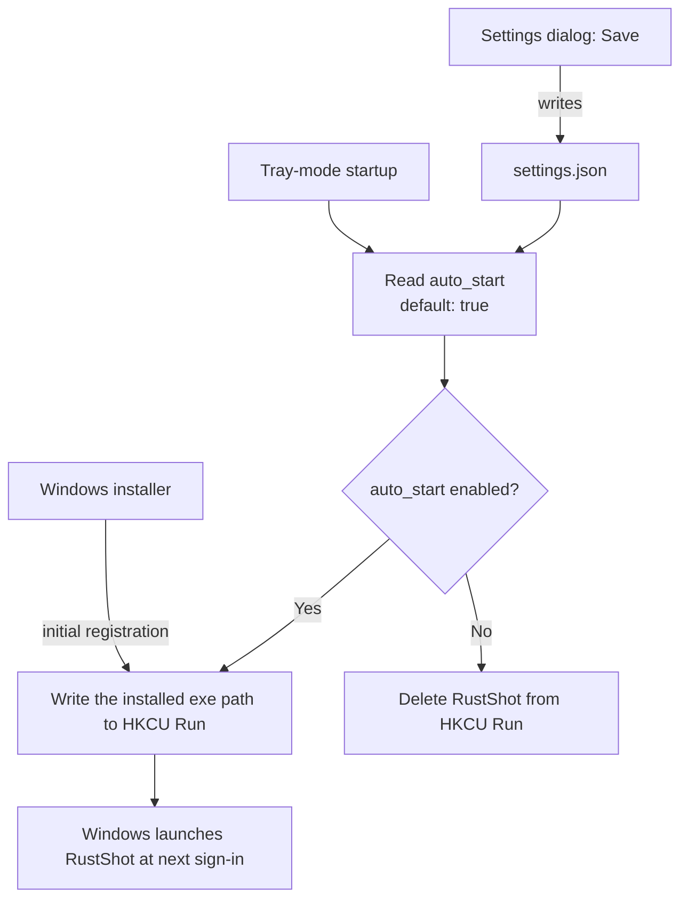
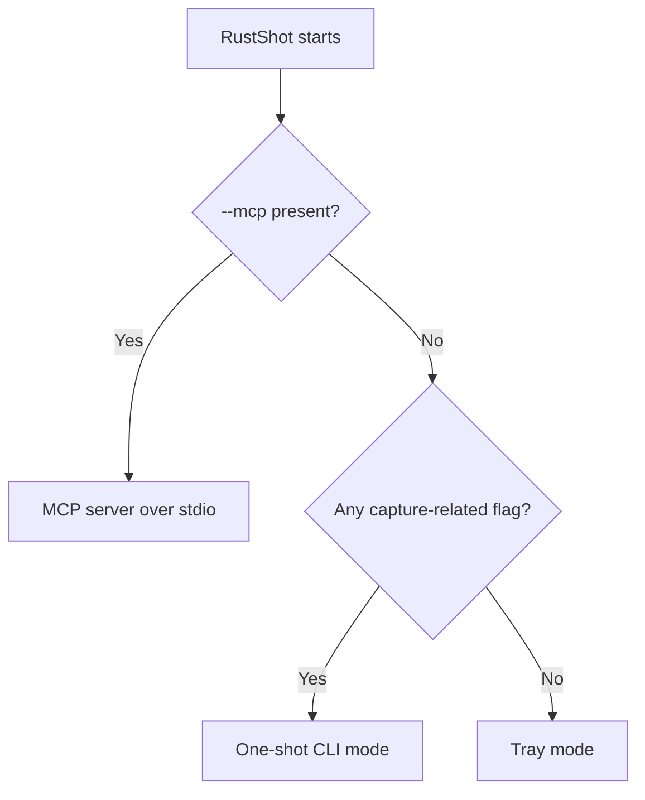
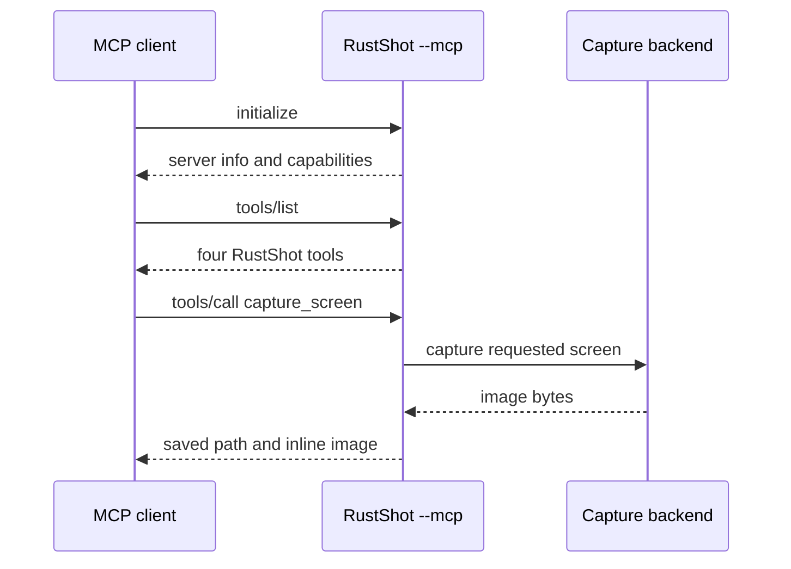

# 📖 RustShot Tutorial, part 2

[← Part 1 lives in the README](../README.md#-tutorial-part-1--fresh-clone-to-first-screenshot):
fresh clone → `cargo build --release` → tray icon → first `PrintScreen` capture.
If you haven't done that yet, start there — this page assumes a built binary at
`target/release/RustShot.exe` (`target/release/RustShot` on 🐧🍎) and a tray icon
you can actually see.

Everything below is a task. Commands are runnable exactly as written; every error
message quoted here is the literal string RustShot produces.

**Steps:** [5 — active window](#-step-5--capture-one-window) ·
[6 — recording](#-step-6--record-your-screen-windows) ·
[7 — settings](#-step-7--the-settings-dialog) ·
[8 — auto-start](#-step-8--auto-start-and-where-settings-live) ·
[9 — the CLI](#-step-9--drive-it-from-the-command-line) ·
[10 — MCP](#-step-10--let-an-ai-take-the-screenshots) ·
[platforms](#-platform-reality-check) ·
[troubleshooting](#-troubleshooting) ·
[where next](#-where-to-go-next)

---

## 🪟 Step 5 — capture one window

**Windows only.** Off Windows every route here answers
`Active window capture is only supported on Windows`.

Focus a window and press **`Alt+PrintScreen`**, or right-click the tray icon →
*Capture Active Window (Alt+PrintScreen)*.

Unlike Windows' own `Alt+PrintScreen`, RustShot writes a **file** and never
touches the clipboard. It goes to the screenshots folder in the format selected
in Settings — PNG unless you changed it.

To pick a window that isn't focused, list them first:

```console
$ RustShot.exe --list-windows
Open windows:
  329230  dceiopmdev02.int.kn - Remote Desktop Connection
  13305984  Setup
```

Then capture one by id:

```bash
RustShot.exe --window-id 329230
```

A stale id fails with `No window with id <id>`. Re-run `--list-windows` — ids are
OS window handles and don't survive the window closing.

---

## 🎬 Step 6 — record your screen (Windows)

Recording is Windows-only by design: the pipeline is H.264 through Media
Foundation. Elsewhere it stops before the overlay even opens, with
`Recording is only supported on Windows`.

1. Press **`Ctrl+Shift+R`** (or tray → *Start or Stop Recording (Ctrl+Shift+R)*).
2. The selection overlay opens. **Drag the region you want to record.** This step
   is easy to miss — nothing is captured until you've dragged.
3. Press **`Ctrl+Shift+R`** again to stop. The MP4 lands in the recordings
   folder as `recording_<timestamp>.mp4`.

Three things worth knowing before your first take:

- **The region must fit inside a single monitor.** There is no compositing path
  across screens; a region spanning two monitors is rejected with
  `Recording selection must stay within a single monitor`.
- **There is no recording indicator.** The tray menu is built once at startup,
  and nothing changes the icon or tooltip while recording. If you're unsure
  whether you're recording, check the recordings folder — or the log (below).
- **Don't use *Exit* while recording.** The recorder is a child process that
  stops when the tray parent creates `%TEMP%\rustshot_stop_<pid>.flag` for the
  child's pid. Choosing *Exit* just ends the parent's event loop, so the child
  keeps recording indefinitely. Stop the recording first. If you already exited,
  create that flag file yourself for the child's pid.

Cancelling the overlay with `Esc` aborts the recording silently — that's
deliberate, not a failure.

---

## ⚙️ Step 7 — the Settings dialog

Right-click the tray icon → **Settings**. On Windows this is a native dialog with
exactly six controls:

| Control | Notes |
|---|---|
| **Screenshots folder** | Read-only text — use **Browse** to pick a folder. Empty is rejected: `Screenshots folder cannot be empty.` |
| **Recordings folder** | Same, with its own message. |
| **Default format** | `png` / `jpg` / `bmp`. Used by `Alt+PrintScreen` and by CLI captures with no explicit `--format`. |
| **Recording FPS** | 1–240. Out of range is rejected before saving. |
| **Start with Windows** | The auto-start switch — see [step 8](#-step-8--auto-start-and-where-settings-live). |
| **Save** / **Cancel** | Only **Save** writes anything. |

Off Windows, the *Settings* menu item writes the current settings to disk and
opens the JSON file in your default editor instead.

The important part: **`settings.json` does not exist until you press Save.** Until
then RustShot runs on the built-in defaults —
`<Pictures>\RustShot`, `<Pictures>\RustShot\recordings`, PNG, 30 fps, auto-start
on. The file, once written, is at:

```text
%APPDATA%\RustShot\settings.json      # 🪟
~/.config/RustShot/settings.json      # 🐧 (and the platform config dir on 🍎)
```

Folders are created lazily, not at startup, so a fresh install has no
`Pictures\RustShot` yet. Tray → **Open Screenshots Folder** creates it and opens
it — that's the quickest way to make it exist.

---

## 🔑 Step 8 — auto-start, and where settings live

On Windows, **auto-start is on by default**. Every time tray mode starts it
synchronises this registry value with the setting:

```text
HKCU\Software\Microsoft\Windows\CurrentVersion\Run\RustShot = "<path of the exe you launched>"
```



Four consequences:

- It's `HKCU`, never `HKLM` — deliberately, so RustShot never needs admin rights.
- The value is **the exe you launched last**. Run it from `target\release\` and
  that build directory becomes your login entry.
- Deleting the value by hand does **not** stick: the next tray start writes it
  back.
- The sync is two-way, so there is a real off switch.

**To turn it off:** tray → **Settings** → untick **Start with Windows** →
**Save**. That writes `"auto_start": false` into `settings.json` (creating the
file if this is your first save) and deletes the registry value.

Off Windows the setting exists but does nothing — the sync is Windows-only.

> The Windows installer writes the same `HKCU\...\Run\RustShot` value at install
> time (see [INNO_SETUP_PIPELINE.md](INNO_SETUP_PIPELINE.md)), so both the
> installer and the running app touch that key. The app is the one that keeps
> rewriting it.

---

## 💻 Step 9 — drive it from the command line

**The routing rule first**, because it surprises people: any capture-related flag
puts RustShot into one-shot CLI mode. `--cli`, `--list`, `--window`, `--output`,
`--screen`, an explicit `--format`, `--list-windows` and `--window-id` each do it
alone; `--mcp` beats all of them; only a bare command line reaches tray mode. So
`RustShot --format jpg` takes one screenshot and exits — it does *not* start the
tray with JPEG as the default.



List your monitors (0-based):

```console
$ RustShot.exe --list
Available screens:
  Screen 0: 1920x1200
  Screen 1: 1920x1080
```

Capture a specific one, to a specific place:

```bash
RustShot.exe --screen 1 --output C:\tmp\second-monitor.png
```

`--output` is used **verbatim**, so a bare filename lands in the current
directory, not in the screenshots folder. The extension picks the format; an
unknown one is rejected rather than guessed:

```text
Unsupported output extension '.gif'. Use png, jpg, or bmp, or pass --format explicitly.
```

> 🪟 **Why you may see no output at all.** RustShot is a Windows GUI-subsystem
> binary, so it has no attached console. In PowerShell the process returns
> immediately, prints nothing, and leaves `$LASTEXITCODE` empty. Pipe it to force
> the wait — `.\RustShot.exe --cli | Out-String` — or run it from `cmd.exe`,
> where `Screenshot saved to: ...` and `ERRORLEVEL` both behave.

---

## 🤖 Step 10 — let an AI take the screenshots

`RustShot --mcp` serves the [Model Context Protocol](https://modelcontextprotocol.io)
over stdio as newline-delimited JSON-RPC. Smoke-test it before wiring up a client
— two requests in, two responses out:

```bash
printf '{"jsonrpc":"2.0","id":1,"method":"initialize","params":{}}\n{"jsonrpc":"2.0","id":2,"method":"tools/list","params":{}}\n' \
  | ./target/release/RustShot.exe --mcp
```

The first response identifies the server:

```json
{"id":1,"jsonrpc":"2.0","result":{"capabilities":{"tools":{}},"protocolVersion":"2024-11-05","serverInfo":{"name":"rustshot","version":"0.1.0"}}}
```

The second lists exactly four tools:

| Tool | Arguments | Notes |
|---|---|---|
| `list_screens` | — | Displays as human-readable lines. |
| `list_windows` | — | `<id>  <title>` lines. Windows only. |
| `capture_screen` | `screen` (0-based), `format`, `output_path` — all optional | Saves a file **and** returns the image inline. |
| `capture_window` | `id` (required), `format`, `output_path` | Windows only. Same dual result. |

The capture tools return a `Saved to <path>` text block followed by a base64
`image` block, so the assistant can look at the screenshot rather than just be
told where it is.



Client config:

```json
{
  "mcpServers": {
    "rustshot": { "command": "RustShot.exe", "args": ["--mcp"] }
  }
}
```

Use an absolute path to the exe if it isn't on `PATH`. The protocol contract is
pinned by `tests/features/mcp_server.feature`, so if a response shape ever
changes, that spec fails.

---

## 🌍 Platform reality check

**🐧 Linux.** Screenshots and the tray work. The tray needs
`libayatana-appindicator3` **at runtime**, not just to build: the underlying
library `dlopen`s it and *panics* when it's missing, so the process dies rather
than logging a friendly error. Install the full set from the README's
[Prerequisites](../README.md#-prerequisites). Recording and active-window capture
are unavailable.

**🍎 macOS.** Screenshots, the tray icon and the tray menu work. The hotkeys are
`PrintScreen` and `Alt+PrintScreen` — keys Apple keyboards don't have — and there
is no rebinding UI, so drive it from the tray menu or the CLI. *Capture Active
Window* answers `Active window capture is only supported on Windows`, and
recording answers `Recording is only supported on Windows`.

**Both.** The region-selection overlay is fully supported: it covers the monitor
under the cursor and freezes that monitor's screenshot while you drag.

---

## 🔧 Troubleshooting

| Symptom | What's happening |
|---|---|
| 🪟 No tray icon after launch | Windows 11 put it in the hidden-icons flyout. Click `^`, drag the blue camera icon onto the taskbar. Promotion is stored per exe path. |
| Nothing behind the `^` chevron either | RustShot exited during startup. Read the last line of `%APPDATA%\RustShot\rustshot.log`. |
| Log says ``Failed to register PrintScreen hotkey: ...`` | Another app — often a second RustShot started by the auto-start entry — owns `PrintScreen`, `Alt+PrintScreen` or `Ctrl+Shift+R`. Registration is all-or-nothing, so one conflict stops startup. Close the other instance. |
| 🪟 A CLI command prints nothing | GUI-subsystem binary, no console. Pipe it or use `cmd.exe` — see [step 9](#-step-9--drive-it-from-the-command-line). |
| Clicking in the overlay does nothing | Drags of 5 px or less are discarded so click jitter can't produce accidental captures. Drag further. The overlay stays open for another try. |
| `Esc` produced no file and no error | `Selection cancelled` is deliberately silent. |
| `Recording selection must stay within a single monitor` | The dragged region crossed a monitor boundary. Keep it on one screen. |
| `Recording is only supported on Windows` | Working as designed. |
| `--list-windows` prints `No open windows found.` off Windows | Window enumeration is Windows-only. |
| Auto-start entry reappears after you delete it in regedit | Tray mode rewrites it on every start. Use Settings → untick **Start with Windows** → **Save**. |
| An MP4 keeps growing after you chose *Exit* | The recorder child was orphaned. Create `%TEMP%\rustshot_stop_<pid>.flag` for its pid, or end the process. |

The log is `%APPDATA%\RustShot\rustshot.log`, opened in append mode at debug
level and never rotated — delete it if it gets big.

---

## 🗺️ Where to go next

- **How it works:** the design rationale is rustdoc next to the code. Start at
  [`src/lib.rs`](../src/lib.rs), and see [`docs/README.md`](README.md) for the
  pointer table of non-obvious constraints. (Or read it in a browser:
  `cargo doc --all-features --no-deps --open`.)
- **What it promises:** the Gherkin features in
  [`tests/features/`](../tests/features/) *are* the behavioural spec. Run them
  with `cargo test --test bdd`.
- **Contributing:** `cargo fmt`, `cargo lint`, `cargo test` — `cargo lint` is the
  alias CI runs; bare `cargo clippy` exits 0 even with findings.
- **Packaging:** [`INSTALLERS.md`](INSTALLERS.md) and
  [`INNO_SETUP_PIPELINE.md`](INNO_SETUP_PIPELINE.md).
