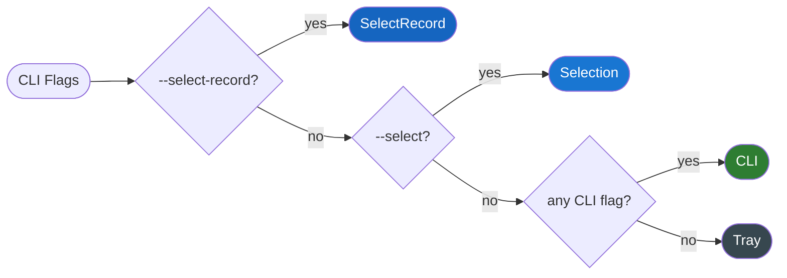
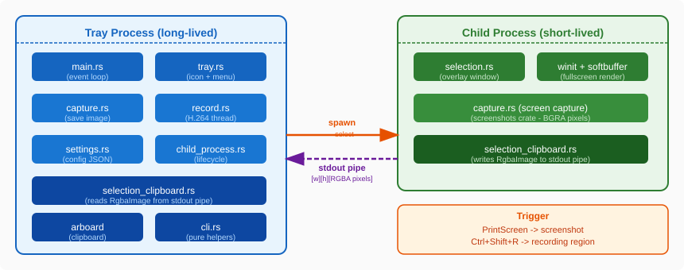
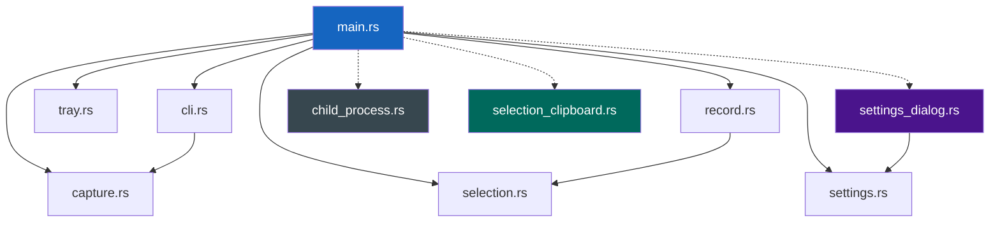
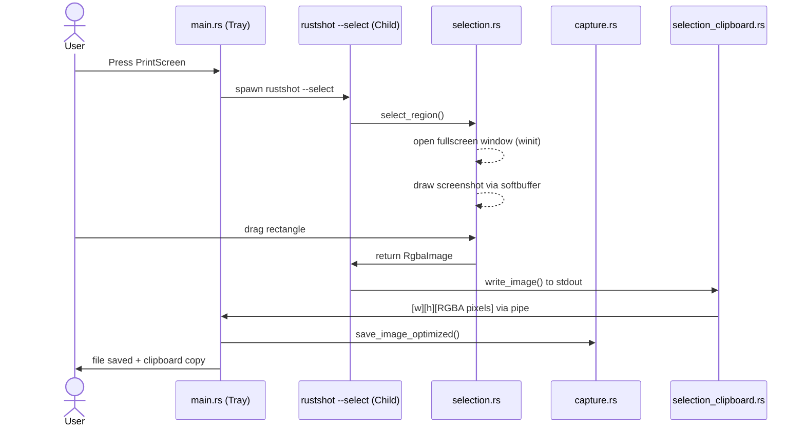
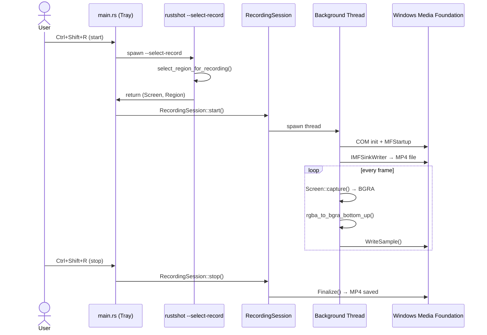
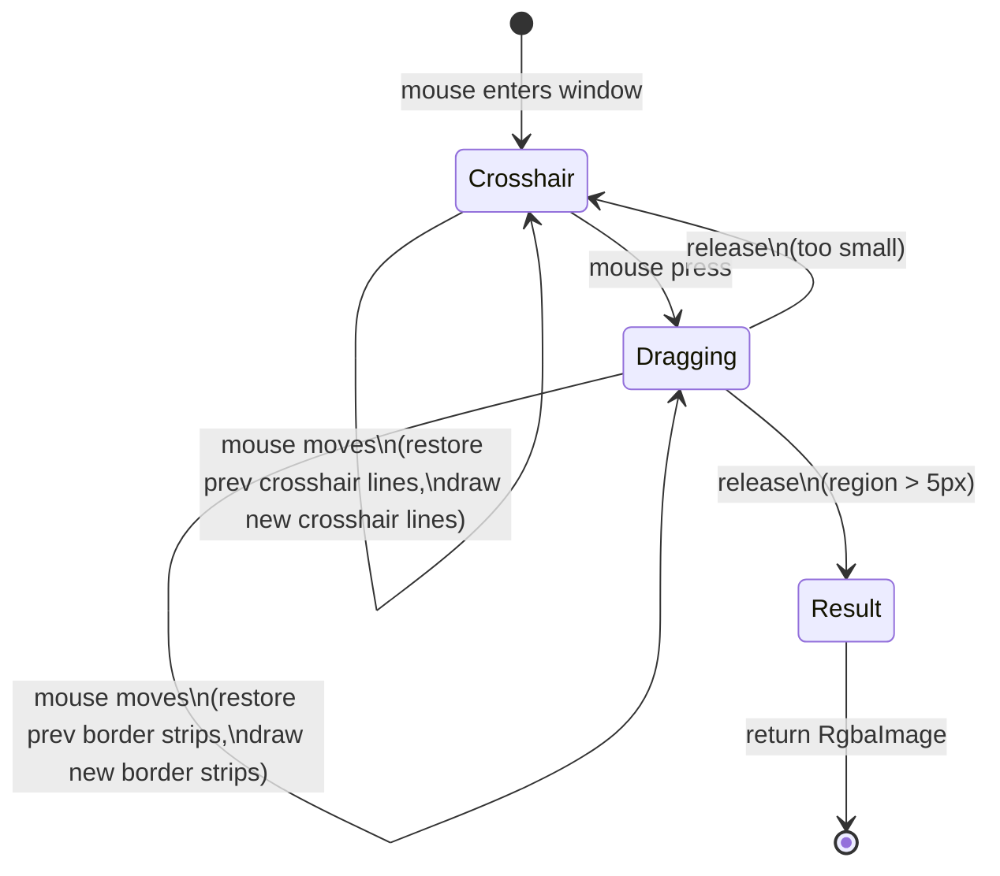
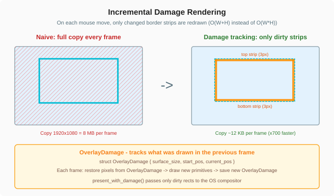
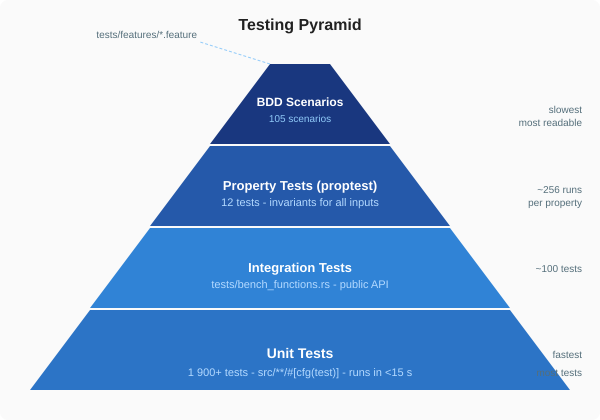

# RustShot Architecture Tutorial

A deep-dive into how RustShot works and the Rust patterns it uses.

---

## Table of Contents

1. [Bird's-Eye View](#1-birds-eye-view)
2. [Application Modes](#2-application-modes)
3. [Module Map](#3-module-map)
4. [Data Flow](#4-data-flow)
5. [Module Deep Dives](#5-module-deep-dives)
6. [Key Design Decisions](#6-key-design-decisions)
7. [Rust Patterns in This Codebase](#7-rust-patterns-in-this-codebase)
8. [Testing Architecture](#8-testing-architecture)
9. [How to Add a New Feature](#9-how-to-add-a-new-feature)

---

## 1. Bird's-Eye View

RustShot is a **single binary** that behaves differently depending on its
command-line flags. The same executable is both the tray application and the
selection overlay child process. It compiles as a Windows GUI subsystem binary
(no console window appears on Windows) but also runs on Linux.

```
rustshot.exe
    ├── Tray mode     — no flags, long-lived process
    ├── CLI mode      — --output / --cli flags, run once and exit
    └── Selection     — --select / --select-record (internal, spawned by Tray)
```

The separation of the Tray and Selection processes is the most important
architectural decision in the application. See [Child Process Isolation](#62-child-process-isolation).

---

## 2. Application Modes

The mode is decided once at startup by `cli::decide_app_mode`. The decision
is pure: it takes a struct of flags and returns an enum. No I/O happens.



```rust
pub struct AppModeRequest {
    pub select_record: bool, // --select-record flag
    pub select: bool,        // --select flag
    pub cli: bool,           // --cli flag
    pub list: bool,          // --list flag
    pub window: bool,        // --window flag
    pub has_output: bool,    // --output flag present
    pub has_screen: bool,    // --screen flag present
    pub format_explicit: bool, // --format flag explicitly set
}

pub enum AppMode {
    Tray,         // No relevant flags: run tray + hotkeys
    Cli,          // Any CLI flag: capture once and exit
    Selection,    // --select: overlay for screenshot
    SelectRecord, // --select-record: overlay for recording region
}
```

Priority order (first match wins):
1. `select_record` → `SelectRecord`
2. `select` → `Selection`
3. Any CLI flag → `Cli`
4. No flags → `Tray`

**Why pure?** Because `decide_app_mode` can be tested without any real CLI
parsing or filesystem access. The BDD suite tests every combination in
`tests/features/app_mode.feature`.

---

## 3. Module Map



> Solid arrows = module imports. Red arrows = type dependency only.
> Dashed arrows = modules that live in `main.rs`, not `lib.rs`.



```
src/
├── lib.rs              ← Public API surface (re-exports modules for tests/benches)
├── main.rs             ← Entry point, routing, tray event loop, Win32 autorun
│
├── cli.rs              ← Pure helpers: mode decision, format resolution, output paths
├── capture.rs          ← Screenshot capture: screen selection, pixel conversion, file save
├── selection.rs        ← Interactive overlay: fullscreen window, crosshair, region drag
├── record.rs           ← H.264 recording via Windows Media Foundation (Windows only)
├── settings.rs         ← JSON config read/write (no serde), path helpers
├── settings_dialog.rs  ← Native Win32 settings dialog (Windows only, not in lib.rs)
├── tray.rs             ← Tray icon, context menu, compile-time icon rasterization
│
├── child_process.rs    ← Child process lifecycle management (selection + recording)
├── folder.rs           ← Open directory in OS file manager (Windows ShellExecute)
├── gdi.rs              ← Windows GDI helpers for screen capture (Windows only)
├── linux_desktop.rs    ← Linux-specific notification helpers
└── selection_clipboard.rs ← IPC: send captured image from child to tray process
```

**Key rule:** Every module in `lib.rs` must have no side effects at import time.
`settings_dialog.rs`, `child_process.rs`, `folder.rs`, etc. are in `main.rs`
only — they contain platform-specific code or process-lifecycle logic that
would make library consumers unsafe or untestable.

---

## 4. Data Flow

### Screenshot (Tray → PrintScreen)



### Recording (Windows only)



```
User presses PrintScreen
        │
        ▼
main.rs: RustShotApp::about_to_wait()
        │  receives GlobalHotkey event
        │
        ▼
main.rs: run_select_capture()
        │  spawns `rustshot --select` child process
        │
        ▼  (child process)
selection.rs: select_region()
        │  opens fullscreen overlay window via winit
        │  draws screenshot background via softbuffer
        │  user drags a rectangle
        │  returns cropped RgbaImage
        │
        ▼
selection_clipboard.rs: write_image()
        │  serializes: 4B width + 4B height + raw RGBA pixels
        │  sends over the child's stdout pipe
        │
        ▼  (back in tray process)
selection_clipboard.rs: read_image()
        │  deserializes from child's stdout
        │
        ▼
capture.rs: save_image_optimized()
        │  saves to disk (PNG fast path or JPG/BMP)
        │
        ▼
arboard: copy to clipboard
```

### CLI Mode

```
rustshot --output /tmp/shot.png
        │
        ▼
cli.rs: effective_cli_format()   ← format from extension or --format flag
capture.rs: capture_screenshot() ← capture + save
        │
        ▼
exit(0)
```

### Recording (Windows only)

```
User presses Ctrl+Shift+R
        │
        ▼
main.rs: spawns `rustshot --select-record` child
        │
        ▼  (child)
selection.rs: select_region_for_recording()
        │  returns (Screen, Region) — which screen + which area
        │
        ▼  (back in tray)
record.rs: RecordingSession::start()
        │  spawns background thread
        │  background thread runs wmf_record():
        │    1. COM init + MFStartup
        │    2. IMFSinkWriter → MP4 file
        │    3. capture frames → convert RGBA→BGRA bottom-up → write sample
        │    4. loop until stop_rx receives signal
        │
        ▼
User presses Ctrl+Shift+R again
        │
        ▼
RecordingSession::stop() → joins thread → finalizes MP4
```

---

## 5. Module Deep Dives

### 5.1. `cli.rs` — Pure Logic Layer

`cli.rs` contains **only pure functions** — no I/O, no filesystem, no
process spawning. This is deliberate: every function in `cli.rs` is called
by tests without any setup overhead.

Key functions:

| Function | Purpose |
|---|---|
| `decide_app_mode` | Map CLI flags to `AppMode` enum |
| `effective_cli_format` | Resolve format: explicit flag > extension > settings |
| `format_from_extension` | `.png` → `Format::Png`, case-insensitive |
| `format_from_output_extension` | Convenience wrapper |
| `should_run_cli_mode` | `true` if any CLI flag is set |
| `format_screen_list_output` | Format screen list for `--list` output |
| `selection_stderr_message` | Classify child process stderr messages |
| `write_error_line` | Write `"Error: {msg}\n"` to any `Write` impl |

Pattern: **inject output, not format to a hard-coded sink.**

```rust
// Bad: writes to stderr directly, untestable
fn report_error(msg: &str) {
    eprintln!("Error: {msg}");
}

// Good: takes any writer, testable with Vec<u8>
pub fn write_error_line<W: Write>(mut writer: W, message: &str) -> io::Result<()> {
    writeln!(writer, "Error: {message}")
}
```

### 5.2. `capture.rs` — Screenshot Pipeline

The capture pipeline is split into small, independently-testable functions
connected by a higher-level coordinator `capture_screenshot_with`.

```
resolve_screen_index()    ← which monitor?
        │
        ▼
Screen::capture()         ← raw BGRA pixels from the OS
        │
        ▼
bgra_to_rgba()            ← swap R and B channels in-place
        │
        ▼
resolve_output_path()     ← generate timestamped filename or use explicit path
        │
        ▼
ensure_parent_directory() ← create dirs if needed
        │
        ▼
save_image_optimized()    ← PNG fast path / JPG / BMP
```

**Testing strategy:** `capture_screenshot_with` accepts injected closures for
the capture step and the save step:

```rust
fn capture_screenshot_with(
    screen_count: usize,
    screen_index: Option<usize>,
    capture_fn: impl FnOnce() -> Result<impl AsRef<[u8]>, String>,
    output: Option<PathBuf>,
    format: Format,
    dir: &Path,
    ensure_dir: impl FnOnce(&Path) -> Result<(), String>,
    save_fn: impl FnOnce(&RgbaImage, &Path, Format) -> Result<(), String>,
) -> Result<PathBuf, String>
```

The real `capture_screenshot` calls this with the real OS functions. Tests
pass stub closures that return fixed data.

### 5.3. `selection.rs` — Interactive Overlay

This is the most complex module. It has three jobs:

1. **Screen geometry** — determine which monitors exist, their physical
   coordinates, and how they map to the logical coordinate space used by
   the OS API. This is needed because high-DPI monitors report logical
   sizes but capture returns physical pixel counts.

2. **Overlay window** — fullscreen, borderless, always-on-top window that
   shows the captured screenshot and draws the selection UI on top.

3. **Incremental rendering** — instead of copying the entire framebuffer on
   every mouse move, the overlay tracks which pixels changed (`OverlayDamage`)
   and only repaints the border strips or crosshair lines that moved.

#### Selection Overlay Rendering





```
pack_rgba_to_softbuffer()    ← convert screenshot RGBA → 0x00RRGGBB once at init
        │
        ▼ (each mouse move)
update_selection_overlay_frame()
        │
        ├─ if surface size changed → full copy from packed_background
        │
        └─ else:
              restore_overlay_row_span()   ← restore pixels damaged in previous frame
              draw_overlay_primitives()    ← draw border strips or crosshair lines
        │
        ▼
overlay_present_damage_rects()   ← compute minimal set of dirty rects for the OS
        │
        ▼
buffer.present_with_damage()     ← blit only the dirty regions
```

The `OverlayDamage` struct tracks the previous frame's drawn primitives so
the restore step knows exactly which pixels to clear:

```rust
pub struct OverlayDamage {
    pub surface_size: Option<(usize, usize)>,
    pub start_pos: Option<(i32, i32)>,  // drag start
    pub current_pos: Option<(i32, i32)>, // current cursor
}
```

#### DPI Coordinate Clamping

The cursor coordinates from winit use the screenshot's dimensions for
clamping, but the softbuffer surface uses `window.inner_size()`. On
secondary monitors with different DPI these can differ by 1–2 pixels.

The `drag_border_coords` helper clamps `x2` and `y2` to the last valid
pixel before computing border ranges:

```rust
fn drag_border_coords(
    start: (i32, i32),
    end: (i32, i32),
    buf_w: usize,
    buf_h: usize,
) -> (usize, usize, usize, usize) {
    let x1 = start.0.min(end.0).max(0) as usize;
    let y1 = start.1.min(end.1).max(0) as usize;
    let x2 = (start.0.max(end.0).max(0) as usize).min(buf_w.saturating_sub(1));
    let y2 = (start.1.max(end.1).max(0) as usize).min(buf_h.saturating_sub(1));
    (x1, y1, x2, y2)
}
```

Without this clamp, a cursor at `y = buf_h` produces an empty loop range
`(buf_h - 1)..buf_h.min(buf_h)` = `(buf_h - 1)..buf_h`, and the border
pixel at the bottom edge disappears. This was the root cause of the
secondary-monitor border bug.

#### Multi-Monitor Support

`SelectionApp` opens one overlay window per monitor. The active monitor
tracks where the cursor is. When dragging starts, the selection is locked
to that monitor even if the cursor crosses into another one.

Cursor movement is clamped to the active monitor's physical bounds during
a drag to prevent the selection from extending beyond one screen.

### 5.4. `record.rs` — H.264 Recording (Windows)

Recording runs on a background thread so the tray UI stays responsive.

```rust
pub struct RecordingSession {
    stop_tx: mpsc::SyncSender<()>,
    thread: Option<thread::JoinHandle<Result<PathBuf, String>>>,
    output_path: PathBuf,
}
```

The recording loop (`wmf_record`) does:

1. `CoInitializeEx` (COM apartment)
2. `MFStartup` (Media Foundation)
3. `MFCreateSinkWriterFromURL` → MP4 container writer
4. Configure video stream: H.264, target bitrate, frame rate
5. Loop: capture → `rgba_to_bgra_bottom_up` → `WriteSample`
6. On stop signal: `Finalize` → `MFShutdown` → `CoUninitialize`

**Key pixel format detail:** Media Foundation's RGB32 encoder expects pixels
in BGRA order with the image vertically flipped (bottom row first). The
`rgba_to_bgra_bottom_up` function does both: it reverses the row order and
swaps R and B channels.

**Dimension alignment:** H.264 requires even width and height. The
`encoded_dimension` function rounds up to even and enforces the codec's
minimum dimension (64 pixels).

### 5.5. `settings.rs` — Configuration Persistence

Settings are stored in `AppData/Roaming/RustShot/settings.json` on Windows.
The JSON is hand-rolled: no `serde` or `serde_json` dependency.

```json
{
  "screenshots_dir": "C:\\Users\\alice\\Pictures\\RustShot",
  "recordings_dir": "C:\\Users\\alice\\Pictures\\RustShot\\recordings",
  "default_format": "png",
  "recording_fps": 30,
  "auto_start": false
}
```

The parser uses `find_json_value` to extract values by key:

```rust
fn find_json_value(json: &str, key: &str) -> Option<&str> {
    let needle = format!("\"{}\"", key);
    // Find the key, skip whitespace and ':', return the value token
}
```

This is intentionally simple. It handles the one known schema without
supporting arbitrary JSON. If the file is malformed or fields are missing,
defaults are used — no error dialog, no crash.

**Why no serde?** The settings schema has 5 fields and has not changed in
months. Pulling in `serde` + `serde_json` adds ~30 transitive crates,
increases compile time by ~15 seconds, and adds ~200KB to the binary.

### 5.6. `tray.rs` — System Tray

The tray icon is a 32×32 camera glyph **computed at compile time** via a
`const fn`:

```rust
const DEFAULT_ICON_PIXELS: [u8; 32 * 32 * 4] = compute_default_icon_pixels();

const fn compute_default_icon_pixels() -> [u8; 32 * 32 * 4] {
    let mut pixels = [0u8; 32 * 32 * 4];
    let mut y = 6u32;
    while y <= 26 {
        let dy = if y >= 16 { y - 16 } else { 16 - y };
        // ... draw camera body, lens, flash
        y += 1;
    }
    pixels
}
```

The context menu is built once in `build_tray_icon()` and then updated by
replacing `Start Recording` / `Stop Recording` items based on state.

Menu events are received from `MenuEvent::receiver()` and dispatched in the
winit event loop's `about_to_wait` handler in `main.rs`.

---

## 6. Key Design Decisions

### 6.1. No `serde`

Consequence: the settings JSON parser is hand-rolled (~200 lines). The
trade-off: no 30-crate dependency tree, 15-second faster incremental builds,
and a binary ~200KB smaller.

Acceptable because: the schema is fixed, tiny, and stable.

### 6.2. Child Process Isolation

The tray process never opens a window. Selection overlay and recording region
selection run in short-lived child processes launched with `--select` or
`--select-record`.

**Why?** The `winit` event loop and the `tray-icon` event loop cannot share
a thread on Windows. If both run in the same process, the overlay window's
message loop blocks the tray's hotkey listener. Isolating them in separate
processes avoids the deadlock entirely.

**IPC:** The child process sends its result to the tray via stdout.
`selection_clipboard.rs` serializes the captured image as:
`[width: 4LE][height: 4LE][raw RGBA pixels]`. The tray reads from the
child's stdout pipe.

### 6.3. `Result<T, String>` Everywhere

The codebase uses `Result<T, String>` instead of a typed error enum. This
is appropriate for an end-user application (not a library):

- Error messages are human-readable by construction
- No `From` impl boilerplate for wrapping errors
- `format!("Failed to save: {e}")` composes naturally

If RustShot were a library, a typed error enum (`thiserror`) would be
the right choice so callers could match on specific variants.

### 6.4. `softbuffer` for the Overlay

The selection overlay needs to display a fullscreen screenshot and draw a
thin 3-pixel border on top. Options considered:

| Option | Problem |
|---|---|
| OpenGL / wgpu | Requires a GPU driver, adds ~5 crates |
| `pixels` crate | Wraps `wgpu`, same problem |
| GDI `StretchBlt` | Windows-only, not cross-platform |
| `softbuffer` | CPU-rendered, no GPU dependency, works on all platforms |

`softbuffer` provides a raw pixel buffer backed by the OS compositor.
Writing pixels into it is a `memcpy` to shared memory; the OS blits them
to the screen. This is fast enough for a mouse-tracking overlay.

### 6.5. Incremental Damage Rendering

A naive implementation would copy the entire screenshot buffer into the
softbuffer on every `CursorMoved` event. At 1920×1080 that is 8MB per frame.

Instead, the overlay tracks `OverlayDamage` (the previous frame's drawn
primitives) and on each update:

1. Restores only the pixels that were drawn in the previous frame
   (the 3px border strips or crosshair lines).
2. Draws the new primitives.
3. Passes the union of old and new dirty rects to `present_with_damage`.

At 1920×1080 the dirty region is `O(W + H)` pixels — ~12KB — instead of
8MB. This removes the bottleneck that made the overlay laggy on slow machines.

### 6.6. Compile-Time Icon Rasterization

The tray icon is a fixed 32×32 glyph. Computing it at compile time with a
`const fn` means:

- Zero runtime cost (the pixel array is in the `.rodata` section)
- No external PNG asset to bundle
- No image decoding at startup

The `const fn` uses integer arithmetic only (no floats, no `sqrt`). The
camera lens uses squared-distance comparison to avoid `sqrt` in `const`
context.

---

## 7. Rust Patterns in This Codebase

### 7.1. `lib.rs` as the Public API Gate

`lib.rs` re-exports modules so benchmarks and integration tests can access
them as `rustshot::capture::bgra_to_rgba`. Without this, the compiler would
not let external crates (`benches/`, `tests/`) call module functions.

Rule: only modules that contain pure, testable logic belong in `lib.rs`.
Platform-specific UI modules (`settings_dialog.rs`) stay in `main.rs`.

### 7.2. Injection for Testability

Any function that touches I/O has a `_with` variant that accepts closures:

```rust
// Public entry point — calls the OS
pub fn capture_screenshot(...) -> Result<PathBuf, String> {
    capture_screenshot_with(..., Screen::capture, save_image_optimized)
}

// Testable variant — accepts any closures
fn capture_screenshot_with(
    ...,
    capture_fn: impl FnOnce() -> ...,
    save_fn: impl FnOnce(...) -> ...,
) -> Result<PathBuf, String>
```

Tests pass stubs; production code passes the real functions. No mocking
framework is needed.

### 7.3. `#[cfg(windows)]` for Platform Code

Windows-only code is gated at the module or function level:

```rust
// Entire module only compiles on Windows
#[cfg(windows)]
mod gdi;

// Function only exists on Windows
#[cfg(windows)]
pub fn open_directory(path: &Path) -> Result<(), String> { ... }

// Conditional import
#[cfg(any(windows, test))]
mod folder;
```

The `#[cfg(any(windows, test))]` pattern lets Linux CI compile and test
Windows-only helper functions by stubbing them in test mode.

### 7.4. Benchmark Proxy Functions

`selection.rs` and other modules expose `benchmark_*` functions that
delegate to private functions. This lets benchmarks measure private logic
without making the implementation public:

```rust
// Private function
fn build_physical_screen_layouts(inputs: &[ScreenLayoutInput]) -> Result<...> { ... }

// Public proxy for benchmarks only
#[doc(hidden)]
pub fn benchmark_build_physical_screen_layouts(inputs: &[...]) -> Result<...> {
    build_physical_screen_layouts(...)
}
```

### 7.5. `proptest` for Invariant Testing

Property tests verify mathematical invariants that hold for any input:

```rust
proptest! {
    // Any drag produces a normalized region: origin = min(start, end)
    #[test]
    fn prop_build_region_from_drag_normalization(x1: i32, y1: i32, x2: i32, y2: i32) {
        if let Some(r) = build_region_from_drag((x1, y1), (x2, y2)) {
            prop_assert_eq!(r.physical_x, x1.min(x2));
            prop_assert_eq!(r.physical_y, y1.min(y2));
        }
    }
}
```

These complement unit tests: unit tests check specific cases, property
tests check "for all inputs, this invariant holds."

### 7.6. BDD for Behavior Documentation

The Gherkin feature files in `tests/features/` serve as **executable
specifications**. They document what the application does in plain language
and verify it automatically:

```gherkin
Feature: Application mode routing

  Scenario: Select-record wins over every other flag
    Given the "select_record" flag is set
    And the "select" flag is set
    And the "cli" flag is set
    When the application mode is decided
    Then the application mode is "SelectRecord"
```

New contributors can read the `.feature` files to understand business rules
without reading Rust code.

---

## 8. Testing Architecture



```
tests/
├── bdd.rs                 ← Cucumber BDD runner (cargo test --test bdd)
├── bench_functions.rs     ← Integration tests for public API
├── features/
│   ├── app_mode.feature
│   ├── capture.feature
│   ├── capture_format.feature
│   ├── record_helpers.feature
│   ├── recording.feature
│   ├── selection.feature
│   ├── selection_helpers.feature
│   └── settings.feature
└── ci_security.sh         ← GitLab CI trust-boundary checks (shell)
```

### Layers

| Layer | Location | Runs via |
|---|---|---|
| Unit tests | `src/**/mod tests` | `cargo test` |
| Integration tests | `tests/bench_functions.rs` | `cargo test` |
| BDD scenarios | `tests/features/*.feature` | `cargo test --test bdd` |
| Property tests | `src/**/proptest!` blocks | `cargo test` |
| Benchmarks | `benches/benchmarks.rs` | `cargo bench` |

### Unit Test Placement

Unit tests live in the same file as the code they test, inside a
`#[cfg(test)]` module. This gives them access to private functions:

```rust
fn drag_border_coords(...) -> (usize, usize, usize, usize) { ... }  // private

#[cfg(test)]
mod tests {
    use super::*;

    #[test]
    fn test_render_frame_bottom_border_present_when_drag_end_exceeds_buffer_height() {
        // Can test drag_border_coords indirectly through render_selection_overlay_frame
    }
}
```

### Test Naming Convention

```
test_{module}_{function}_{scenario}
```

Examples:
- `test_render_frame_bottom_border_present_when_drag_end_exceeds_buffer_height`
- `test_multi_monitor_cursor_move_switches_active_monitor_before_drag`
- `test_overlay_perf_crop_packed_region_matches_rgba_crop`

The `_perf_` infix indicates a test that also serves as a correctness check
for a performance-critical path.

---

## 9. How to Add a New Feature

### Step 1: Write a failing test

For a pure logic function, add a unit test:

```rust
#[test]
fn test_my_new_helper_basic_case() {
    assert_eq!(my_new_helper(42), 84);
}
```

For user-visible behavior, add a BDD scenario:

```gherkin
# tests/features/my_feature.feature
Feature: My new feature

  Scenario: Basic case works
    Given the input is 42
    When my new helper is applied
    Then the result is 84
```

### Step 2: Add the logic

Extract testable logic into a small, pure function:

```rust
// In the appropriate module (e.g., cli.rs, capture.rs)
pub fn my_new_helper(input: u32) -> u32 {
    input * 2
}
```

### Step 3: Wire it up

Connect the helper to the actual application path (CLI parsing, tray event,
etc.). Keep this wiring thin — it should just call the pure function.

### Step 4: Run the full suite

```bash
cargo test              # All unit + integration + property tests
cargo test --test bdd   # BDD scenarios
cargo fmt               # Format
cargo clippy -- -D warnings  # Lint
```

### Step 5: Add a benchmark if performance matters

```rust
// benches/benchmarks.rs
fn bench_my_new_helper(c: &mut Criterion) {
    c.bench_function("my_new_helper_1000", |b| {
        b.iter(|| my_new_helper(black_box(1000)));
    });
}
```

### Checklist

- [ ] Pure function extracted from I/O concerns
- [ ] Unit test for the happy path
- [ ] Unit test for the error path
- [ ] Unit test for the boundary case
- [ ] BDD scenario for user-visible behavior (if applicable)
- [ ] Added to `lib.rs` if needed from tests or benchmarks
- [ ] No new dependency unless clearly justified
- [ ] `cargo fmt && cargo clippy` clean
