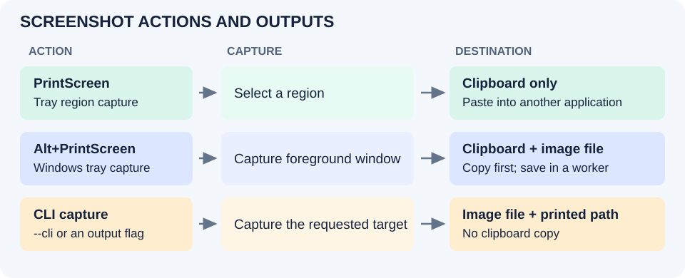
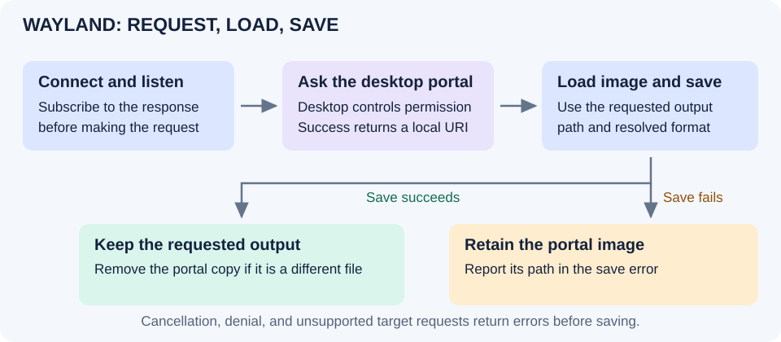

# Capture guide

Choose a capture action by the image you need and where it should go.

## Region, window, or file

| Need | Action | Result |
|---|---|---|
| Paste part of the screen | Start tray mode, press PrintScreen, and drag a region | Clipboard image; no automatic image file |
| Paste the foreground window on Windows | Press Alt+PrintScreen while that window has focus | Clipboard image, followed by a saved copy |
| Save a screenshot from a command | Run `RustShot --cli --output shot.png` | Image file and its path printed to stdout |
| Save a foreground window on Windows | Run `RustShot --window --output window.png` | Image file; no clipboard copy |
| Record a region on Windows | Press Ctrl+Shift+R, select the region, and press the hotkey again to stop | Finalized MP4 in the configured recording directory |

These commands assume the executable is on `PATH`. From a source build, use
`target/release/RustShot` on Linux or macOS, or `target/release/RustShot.exe` on
Windows. Preserve the filename's capitalization on case-sensitive filesystems.

Without `--screen`, the normal monitor capture path prefers the monitor under
the cursor, then falls back to the primary monitor. `--screen` uses the
zero-based indices reported by `--list`.

## Platform boundaries

| Target | Windows | Linux X11 | Linux Wayland | macOS |
|---|---|---|---|---|
| CLI monitor screenshot | Supported | Supported | Full desktop through the portal | Supported |
| Explicit `--screen` | Supported | Supported | Rejected | Supported |
| Active window | Supported | Unavailable | Rejected | Unavailable |
| Region overlay | Supported | Existing X11 path | Still requires the X11 capture path | Supported |
| Screen recording | Supported | Unavailable | Unavailable | Unavailable |

The portal path cannot select one monitor or the active window. RustShot
reports an error for those requests rather than replacing them with a
full-desktop screenshot.

### Wayland screenshot lifecycle

Full-desktop CLI capture uses `xdg-desktop-portal` and the backend for the
current desktop session. The desktop controls any permission prompt. The
portal writes an image and returns its local file URI; RustShot loads that image
and saves it to the requested destination.

After a successful save, RustShot attempts to remove a distinct portal copy.
It does not remove the requested output, including when both paths refer to
the same file. If creating the output directory or saving fails, the error
reports the retained portal image's path. An unreadable portal image is a
separate failure and is discarded when safe.

`XDG_SESSION_TYPE=wayland` selects the portal; `XDG_SESSION_TYPE=x11` selects
the X11 path. Otherwise, a non-empty `WAYLAND_DISPLAY` selects the portal.

## Files, formats, and settings

Screenshots default to `Pictures/RustShot`; recordings default to its
`recordings` subdirectory. Settings can change both locations. An explicit
`--output` takes precedence over the screenshot directory.

Format selection follows this order:

1. An explicitly supplied `--format`.
2. A recognized extension in `--output`.
3. The saved default format.

For example, `RustShot --output photo.jpg` selects JPEG, while
`RustShot --output photo.jpg --format png` explicitly selects PNG. Keep the
extension consistent with the format you request.

On Windows, settings and logs are stored at:

- `%APPDATA%/RustShot/settings.json`
- `%APPDATA%/RustShot/rustshot.log`

On other platforms, they live in the OS configuration directory under
`RustShot`. If the OS cannot provide a configuration or pictures directory,
the corresponding path uses the current directory as its base.

Windows autostart follows `auto_start` in settings and is enabled by default.
The tray's settings entry opens the native Windows settings dialog; other
platforms open the settings file in the default editor.

## Diagnose an unexpected result

| Observation | Check |
|---|---|
| A region selection created no file | Paste the clipboard image; the region flow is clipboard-only. Use CLI capture for a saved file. |
| Alt+PrintScreen copied the wrong window | Put the intended window in the foreground before pressing the hotkey. Capture includes that window's bounds. |
| The window image pasted, but no file appeared | Check the configured screenshot directory and the log for a save error. A save failure does not undo a successful clipboard copy. |
| A window file was saved, but copying failed | Check the log for a clipboard error. Saving still proceeds when the clipboard is unavailable. |
| Wayland reports a missing screenshot portal | Check that the session has `xdg-desktop-portal` and a matching desktop backend running. |
| A Wayland save failed | Use the retained portal file path named in the error, then correct the destination or its permissions. |
| The overlay crosshair flickers or stops before an edge | Record monitor bounds, scaling, refresh rates, and the exact executable used. Run the Windows overlay benchmark to check visibility and edge coverage. |

See the [architecture guide](architecture-tutorial.md) for process boundaries,
clipboard ownership, and rendering, and the [README benchmark commands](../README.md#testing)
for a repeatable Windows overlay check.

## Source references

- [CLI format and mode policy](../src/cli.rs)
- [Monitor, foreground-window, and portal file capture](../src/capture.rs)
- [Wayland session policy and portal response handling](../src/portal.rs)
- [Tray capture and clipboard coordination](../src/main.rs)
- [Settings defaults and paths](../src/settings.rs)
